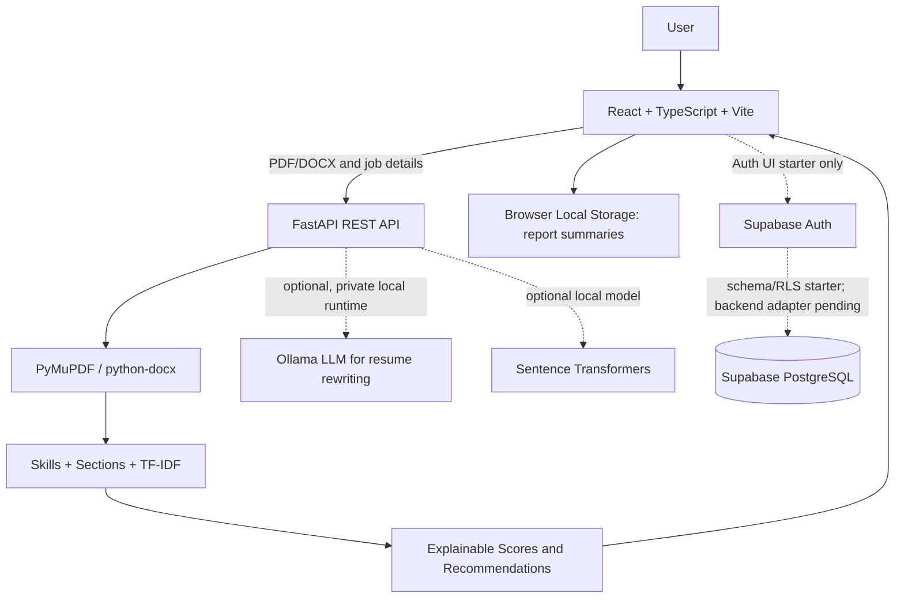

<div align="center">

# ResumeIQ
### AI-Powered Resume Analyzer

**Your Resume. Your Career. Your Next Opportunity.**


</div>

> **Project status:** ResumeIQ is a locally runnable full-stack prototype. It performs real PDF/DOCX parsing and explainable NLP analysis. It has **not** been publicly deployed or prepared for production use. Cloud authentication, server-side user history, account deletion, and API-side Supabase authorization are not complete.
>
> **Analysis notice:** Resume, ATS, and job-match scores are estimates—not hiring predictions or guarantees. The default analyzer uses TF-IDF and deterministic rules. A local Ollama LLM for resume rewriting and optional Sentence Transformers similarity can be enabled separately. LLM output may still be wrong; review every claim.

---

## Table of Contents

- [Project Overview](#project-overview)
- [Problem Statement](#problem-statement)
- [Our Solution](#our-solution)
- [Key Features](#key-features)
- [System Architecture](#system-architecture)
- [Analysis Workflow](#analysis-workflow)
- [Supported Files and Analysis](#supported-files-and-analysis)
- [Technology Stack](#technology-stack)
- [Getting Started](#getting-started)
- [Configuration](#configuration)
- [Using the Prototype](#using-the-prototype)
- [Scoring Methodology](#scoring-methodology)
- [Security, Privacy and Responsible AI](#security-privacy-and-responsible-ai)
- [Testing and Evaluation](#testing-and-evaluation)
- [Suggested Demonstration](#suggested-demonstration)
- [Project Structure](#project-structure)
- [Current Scope and Limitations](#current-scope-and-limitations)
- [Deployment Notes](#deployment-notes)
- [Roadmap](#roadmap)
- [Documentation](#documentation)
- [License](#license)

## Project Overview

ResumeIQ helps students, fresh graduates, and job seekers understand how their resume relates to a target role. It extracts text from a resume, compares that content with a job description, identifies skills it can recognize, and provides a transparent set of scoring signals and revision suggestions.

ResumeIQ does not use invented user counts, success rates, testimonials, or example scores in the dashboard. Dashboard totals come from reports saved in the current browser; an empty workspace remains empty until a real analysis is run.

## Problem Statement

Applicants often have difficulty answering practical questions before applying:

- Does my resume clearly show the required experience and skills?
- Which requirements from this job description are not evident in my resume?
- Is my document organized in a way common resume parsers can read?
- What can I improve without exaggerating or inventing qualifications?

ResumeIQ provides a structured first review to help with those questions. It is a writing and self-assessment aid—not a recruiter, an employer ATS, or an employment decision system.

## Our Solution

ResumeIQ combines PDF/DOCX extraction, rule-based section and skill detection, TF-IDF similarity, job-evidence checks, and an optional local language model for rewriting user-provided text.

Instead of showing an unexplained score alone, ResumeIQ presents:

- **What was detected** in the uploaded text.
- **Which job requirements matched** or were not detected.
- **How the overall score is weighted.**
- **Which ATS-related checks passed or need attention.**
- **What the analysis cannot assess**, such as visual formatting or an employer's specific ATS.

### Design Differentiators

1. **Explainable scoring:** score components and job-match weights are visible.
2. **Evidence over keyword stuffing:** matched requirements are also checked for mention in detected project/experience sections.
3. **No fabricated claims:** the default improver applies conservative wording rules; optional LLM output is clearly marked and must be checked by the user.
4. **Privacy-first local mode:** files are processed for the API request and are not persisted by application code; reports are stored only in browser local storage.
5. **Honest boundaries:** local history, optional Supabase Auth, and the optional LLM are distinguished from services that have not been configured.

## Key Features

### Resume Intake

- Drag-and-drop and file-picker upload.
- PDF and DOCX support, with a **5 MB file limit**.
- Encrypted PDFs, invalid documents, and documents with too little selectable text are rejected with an explanation. Scanned/image-only PDFs are not OCR-processed in the default parser.
- Job title, company, job description, and optional comma-separated priority skills.

### Resume and Job Analysis

- PDF text extraction with PyMuPDF and DOCX parsing with python-docx.
- Curated-vocabulary skill extraction and missing-skill comparison.
- TF-IDF cosine similarity for resume/job text by default.
- Optional local `all-MiniLM-L6-v2` Sentence Transformers mode; the report labels the method actually used and explicitly reports TF-IDF fallback if the model cannot load.
- Explainable resume score, separate job-match score, and estimated ATS score.
- Section presence, contact information, readability signals, project/experience evidence, and targeted improvement suggestions.

### Results and Workspace

- Skill match and gap panels with detected evidence.
- Resume section analysis, ATS checks, score breakdown charts, and job-match visualization.
- Browser print dialog for saving the analysis report as PDF.
- Dashboard charts, skill counts, and analysis history based only on reports saved in this browser.
- Skill roadmaps with external learning resources for recognized gaps.

### Resume Improver

- Supports professional-summary, project-description, achievement-bullet, and grammar/clarity modes.
- Default: conservative deterministic phrase and grammar rules.
- Optional: local Ollama generation using `qwen2.5:3b` when configured on the API host.
- If the local model is unavailable, returns a clearly labeled rules fallback. Numeric claims introduced by a model are rejected; other LLM mistakes remain possible, so users must verify all output.
- Compare original and improved text, apply edits, copy, or download a `.txt` draft.
- The improver does not validate whether user-provided claims are true.

### Optional Account Setup

- Frontend Supabase Auth client wiring and a PostgreSQL schema with RLS policies are included as a starting point.
- Supabase API JWT verification, secure backend user-scoped queries, server-side report sync, protected dashboard routes, account deletion, and cloud resume storage are **not connected** in this prototype.
- Do not interpret the optional sign-in UI or supplied SQL as a completed secure cloud-account implementation.

## System Architecture



```text
Upload → Validate → Extract text → Detect sections/skills
       → Compare job requirements → Score and recommend → Review / print report
```

## Analysis Workflow

1. The browser checks extension and file size for immediate feedback.
2. The API validates request metadata, allowed file type, file size, and job-description length.
3. PDF or DOCX text is extracted for the request; the original file and extracted text are not stored by application code.
4. Resume headings, contact details, skills, sentence/bullet signals, and project/experience sections are analyzed.
5. The API extracts recognizable job skills and important job-description terms, then computes coverage and text similarity.
6. Weighted resume, job-match, and ATS estimates are assembled with missing-skill and section feedback.
7. The report JSON is stored in browser local storage on this device. No server history is available in the default mode.
8. For resume rewriting, the API uses deterministic rules unless the backend is configured for Ollama. Model output is marked as LLM-generated and should be reviewed.

## Supported Files and Analysis

| Input / area | Current behavior | Important limitation |
|---|---|---|
| PDF | PyMuPDF extracts selectable page text | Image-only/scanned pages are not OCR'd |
| DOCX | Paragraphs and table-cell text are extracted | Complex layout and visual styling are not evaluated |
| Skills | Boundary-aware exact matches against a curated skill list | Synonyms and skills absent from the list may be missed |
| Sections | Recognizes common summary, experience, education, skills, projects, and certifications headings | Unusual labels or multi-column reading order may not be recognized |
| Job match | Required-skill coverage, project/experience evidence, text similarity, important keyword coverage | Low-information if no recognizable or manually specified requirements exist |
| ATS estimate | Contact details, section count, structure, readability, and keyword signals | Cannot emulate a particular employer's ATS or assess visual document layout |
| LLM rewrite | Optional local Ollama, only when enabled on the API host | The model can still change meaning or hallucinate; review every phrase |

## Technology Stack

| Layer | Technology |
|---|---|
| Frontend | React, TypeScript, Vite, React Router, Tailwind CSS configuration, Lucide React |
| Charts | Recharts |
| Backend | Python, FastAPI, Pydantic, SlowAPI rate limiting |
| NLP | scikit-learn TF-IDF and cosine similarity; optional Sentence Transformers |
| Document extraction | PyMuPDF, python-docx |
| Optional local LLM | Ollama HTTP API and a locally installed open model |
| Optional authentication/database | Supabase Auth client starter, PostgreSQL schema and RLS policies |
| Tests | Pytest, FastAPI TestClient, Vitest, Testing Library |

## Getting Started

### Prerequisites

- Python **3.10+**.
- Node.js **20+** and npm.
- Optional: Ollama and a compatible local model for LLM rewriting.
- Optional: a Supabase project for experimenting with the provided Auth client and SQL schema. Cloud persistence is not implemented by default.

### 1. Start the Backend

Open a terminal in the project directory:

**macOS / Linux**

```bash
cd resumeiq/backend
python3 -m venv .venv
source .venv/bin/activate
pip install -r requirements.txt
uvicorn app.main:app --reload --host 0.0.0.0 --port 8000
```

**Windows PowerShell**

```powershell
cd resumeiq\backend
python -m venv .venv
.\.venv\Scripts\Activate.ps1
pip install -r requirements.txt
uvicorn app.main:app --reload --host 0.0.0.0 --port 8000
```

Backend health: <http://localhost:8000/api/health>  
Interactive API documentation: <http://localhost:8000/docs>

### 2. Start the Frontend

Open a second terminal:

```bash
cd resumeiq/frontend
npm install
npm run dev
```

Open the Vite URL shown in the terminal, usually <http://localhost:5173>. Keep both backend and frontend processes running. In local development Vite proxies `/api` calls to port `8000`.

### 3. Enable the Optional Local LLM Improver

Install Ollama from [ollama.com/download](https://ollama.com/download), start its local service, then download the model:

```bash
ollama pull qwen2.5:3b
```

Restart the backend with the LLM provider enabled.

**macOS / Linux**

```bash
cd resumeiq/backend
source .venv/bin/activate
LLM_PROVIDER=ollama OLLAMA_MODEL=qwen2.5:3b uvicorn app.main:app --reload --host 0.0.0.0 --port 8000
```

**Windows PowerShell**

```powershell
cd resumeiq\backend
.\.venv\Scripts\Activate.ps1
$env:LLM_PROVIDER = "ollama"
$env:OLLAMA_MODEL = "qwen2.5:3b"
uvicorn app.main:app --reload --host 0.0.0.0 --port 8000
```

ResumeIQ calls Ollama from the backend using `http://127.0.0.1:11434` by default. That address refers to the **backend host**, not the user's browser. Do not expose Ollama publicly; use a trusted private network if API and Ollama are on separate hosts.

### 4. Optional Local Embedding Model

The default job similarity remains TF-IDF. To enable the optional Sentence Transformers path, install the additional dependencies and set the environment variable:

```bash
cd resumeiq/backend
pip install -r requirements-embeddings.txt
ENABLE_SENTENCE_TRANSFORMERS=true uvicorn app.main:app --reload --host 0.0.0.0 --port 8000
```

This downloads open model weights on first use and needs more memory than the TF-IDF default. If the dependency/model cannot load, the report explicitly identifies the TF-IDF fallback.

## Configuration

Copy `.env.example` as a reference; environment variables must be set for the processes. Vite reads `VITE_` variables from `frontend/.env`. Uvicorn does not automatically load the root example file—export backend variables in the shell or configure them in the hosting provider.

| Variable | Default | Purpose |
|---|---|---|
| `VITE_API_URL` | Empty | Leave empty for local Vite proxy; set to API origin in a hosted frontend |
| `VITE_SUPABASE_URL` | Empty | Optional public Supabase project URL for the Auth UI |
| `VITE_SUPABASE_ANON_KEY` | Empty | Optional public anon key; never use service-role keys in frontend code |
| `CORS_ORIGINS` | Local Vite origins | Exact allowed browser origins for FastAPI |
| `LLM_PROVIDER` | `rules` | Set `ollama` to enable local Ollama; rules are default/fallback |
| `OLLAMA_BASE_URL` | `http://127.0.0.1:11434` | Ollama URL accessible from the backend host |
| `OLLAMA_MODEL` | `qwen2.5:3b` | Must match an installed Ollama model tag |
| `LLM_TIMEOUT_SECONDS` | `45` | Ollama request timeout |
| `ENABLE_SENTENCE_TRANSFORMERS` | `false` | Optional local semantic similarity model mode |

## Using the Prototype

### Analyze a Resume

1. Open **Analyze resume** from the workspace.
2. Upload a PDF or DOCX under 5 MB.
3. Paste a job description of at least 20 characters.
4. Optionally add a job title, company, and priority skills.
5. Select **Analyze my resume** and wait for the API response.
6. Review score components, recognized skill gaps, ATS checks, sections, and suggestions.
7. Use **Download report** to open the browser print dialog and choose “Save as PDF.”

### Improve Resume Wording

1. Open **Resume improver**.
2. Select summary, project, bullet, or grammar/clarity mode.
3. Paste only content you want edited.
4. Select **Generate improvement**.
5. Check whether the result is marked **Rules draft** or **Local LLM draft**.
6. Compare every claim with your source text. Apply, copy, or download the draft when satisfied.

If `LLM_PROVIDER=rules` (the default), output is deterministic rule-based wording cleanup. If Ollama is configured, the UI identifies the output as LLM-generated and warns users to verify it.

### Reports and History

- Dashboard and history read actual reports saved in this browser's local storage.
- Reports do not sync between browsers or devices.
- Use Profile & settings to delete saved local reports. Clearing browser storage also removes them.
- The backend's history endpoint intentionally returns empty results until a secure Supabase persistence adapter is implemented.

## Scoring Methodology

### Resume Quality Score

`0.20 × structure + 0.25 × skills relevance + 0.25 × project/experience relevance + 0.15 × keyword relevance + 0.15 × readability/completeness`

### Job Match Score

`0.40 × required-skill coverage + 0.25 × project/experience evidence + 0.25 × text similarity + 0.10 × important keyword coverage`

Text similarity is TF-IDF by default, with an optional local Sentence Transformers mode. Job skills are compared against the resume skill vocabulary. Evidence is checked for recognized matched skills in detected project and experience sections.

### ATS Estimate

A weighted heuristic considers document structure, readability, keyword relevance, completeness, and contact details. It does not simulate an employer's software. ATS outcomes vary by vendor and configuration.

All scores are bounded from 0–100. The scoring guide is documented in [`docs/scoring-methodology.md`](docs/scoring-methodology.md). Scores are not calibrated predictions of hiring outcomes.

## Security, Privacy and Responsible AI

### Implemented Safeguards

- PDF/DOCX extension and request validation; 5 MB file limit.
- Job-description length checks, CORS allowlist, and API rate limiting.
- No server-side storage of uploaded original files, extracted text, or reports in the default mode.
- Report summaries saved locally in the current browser only.
- Supabase SQL schema uses per-user Row Level Security policies as a starter.
- No paid or hosted AI API is called by the default workflow.
- Optional LLM runs through the configured Ollama service; default Ollama URL is local to the API host.
- Generated LLM drafts are marked as LLM output; a numeric-claim guard and rule-based fallback are included.

### Important Boundaries

> A keyword match is not proof of skill. A missing-skill result is not proof that the applicant lacks that skill. An ATS estimate is not an ATS decision. An LLM rewrite is not factual verification.

FastAPI's multipart processing can use ephemeral request buffers; “not persistently stored by the app” is not a promise of zero temporary processing by the runtime. Avoid uploading highly sensitive documents to an unreviewed public service.

Before accepting real users or personal resume data, implement backend Supabase JWT verification, protected routes, user-scoped database access, account deletion, strict production CORS, ingress/body limits, secure logging, retention controls, and an independent security review. The current workspace is a prototype and is **not production-ready**.

## Testing and Evaluation

Backend:

```bash
cd resumeiq/backend
pytest -q
```

Frontend:

```bash
cd resumeiq/frontend
npm test
npm run build
```

The current backend suite covers PDF/DOCX extraction, analysis scores, skills and missing-skill detection, API validation, local-improver transformations, LLM numeric-claim checks, unavailable-Ollama fallback, and non-persistence behavior. The frontend test checks basic route/landing rendering. Authentication authorization and cloud-data deletion tests remain pending because those production features are not implemented.

### Suggested Evaluation

| Metric | Suggested measurement |
|---|---|
| Extraction | Compare extracted text with test documents, including multi-column and table examples |
| Skills | Precision/recall against a labeled resume/job sample |
| Match scoring | Human review of skill coverage and contextual evidence |
| ATS checks | Compare heuristic flags with actual exported document behavior; do not call this ATS pass-rate |
| LLM safety | Check unsupported numbers, titles, technologies, and experience claims in a labeled test set |
| Usability | Measure time to understand and act on report feedback |

No benchmark accuracy, job-offer rate, or success statistic is claimed.

## Suggested Demonstration

Use a test resume you own or a synthetic document.

| Step | Demonstration | Expected observation |
|---|---|---|
| 1 | Open the landing page and workspace | No invented user-count claims or prefilled reports |
| 2 | Upload a PDF/DOCX and add a job description | API validates and extracts the uploaded file |
| 3 | Review analysis results | Scores are broken down; matched/missing skills use actual extracted text |
| 4 | Open scoring guide | Weights and heuristic limitations are visible |
| 5 | Improve a summary with rules enabled | Output labels the deterministic method and preserves source facts |
| 6 | Enable local Ollama and generate again | UI marks the draft as LLM-generated; user must verify it |
| 7 | Stop Ollama and request an improvement | API reports the rules fallback rather than claiming LLM use |
| 8 | Open history and profile | Reports are local to this browser and can be deleted |

## Project Structure

```text
resumeiq/
├── frontend/
│   ├── public/
│   ├── src/
│   │   ├── components/          # Shared component folder
│   │   ├── pages/               # Routed app pages currently composed in App.tsx
│   │   ├── services/api.ts      # API client
│   │   ├── App.tsx
│   │   └── styles.css
│   ├── package.json
│   └── vite.config.ts
├── backend/
│   ├── app/
│   │   ├── api/routes.py        # REST endpoints
│   │   ├── core/rate_limit.py
│   │   ├── schemas/              # Pydantic request contracts
│   │   ├── services/
│   │   │   ├── analyzer.py       # Scoring, skill and section analysis
│   │   │   ├── extraction.py     # PDF/DOCX extraction
│   │   │   └── llm_improver.py   # Ollama integration and fallback
│   │   └── main.py
│   ├── tests/
│   ├── requirements.txt
│   ├── requirements-embeddings.txt
│   └── supabase_schema.sql
├── docs/
├── .github/workflows/tests.yml
├── .env.example
├── LICENSE
└── README.md
```

## Current Scope and Limitations

| Area | Functional prototype | Not yet implemented / not claimed |
|---|---|---|
| Resume analysis | Real PDF/DOCX extraction and deterministic NLP scoring | Employer-specific ATS emulation or hiring-outcome prediction |
| Skill detection | Curated list with contextual evidence checks | Full ontology, synonym coverage, all industries/languages |
| Semantic matching | TF-IDF default; optional local Sentence Transformers | Guaranteed meaning equivalence or multilingual matching |
| Resume improver | Rules by default; optional Ollama model and clear fallback | Hallucination-free generation or factual verification |
| Authentication | Optional Supabase Auth client wiring | Backend JWT verification/protected data APIs |
| History | Browser local storage | Cloud sync, multi-device history, secure per-user persistence |
| Storage/deletion | No server-side originals/reports in local mode; browser delete option | Cloud file retention and complete account-deletion workflow |
| OCR | None in default PDF/DOCX extraction path | Scanned/image-only resume OCR |
| Deployment | Vercel/Render configuration guidance | Public deployment, live domain, connected GitHub repository |

## Deployment Notes

Deployment has **not** been performed. The project includes Vercel SPA configuration and a Render backend blueprint, but requires your own accounts and environment configuration.

- Vercel or another static frontend host can serve the React build; set `VITE_API_URL` to your API origin.
- The FastAPI backend needs a host that supports Python and multipart uploads. Configure `CORS_ORIGINS` to the exact production frontend origin.
- The optional Ollama model must run on or be reachable from the backend host. A browser-side address such as the user's `localhost` is not reachable from a remote API server. Many free backend instances are too small to run a 3B model; keep LLM disabled or run Ollama on a trusted, adequately sized private machine.
- Supabase Free can be used for a small development database, but only after implementing and testing the backend Auth/RLS adapter. Do not put user resumes into the unconfigured schema/API.
- Free hosting limits change. Review provider terms and test cold starts, CORS, file limits, auth callbacks, RLS, and deletion before launch.

No public URL, repository, or deployment success is claimed by this README.

## Roadmap

- Complete Supabase JWT verification, protected routes, user-scoped persistence, and deletion lifecycle.
- Split the routed pages and reusable controls into dedicated frontend modules.
- Add optional scanned-PDF OCR with explicit user notice and resource limits.
- Improve job-skill taxonomy, synonym handling, and multilingual text support.
- Add an authenticated report export service and richer deletion/retention controls.
- Validate local LLM output with broader claim checks and user-controlled model settings.
- Add component-level frontend tests and integration tests for authentication/data ownership.
- Perform security, accessibility, and model-output evaluations before production deployment.

These are planned extensions—not existing prototype capabilities.

## Documentation

- [Architecture](docs/architecture.md)
- [API documentation](docs/api-documentation.md)
- [Scoring methodology](docs/scoring-methodology.md)
- [Optional Supabase schema](backend/supabase_schema.sql)
- [GitHub Actions tests](.github/workflows/tests.yml)

## License

MIT License. See [`LICENSE`](LICENSE).

---

<div align="center">

**Evidence before scores. Truth before polish.**

*ResumeIQ supports better preparation. Employers make hiring decisions.*

</div>
