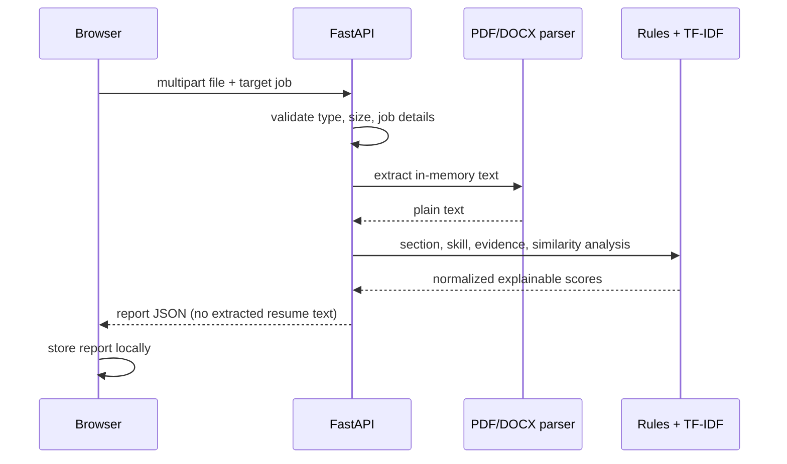

# Architecture

## Runtime boundaries

- **Frontend:** React 18, TypeScript, Vite, React Router, Tailwind CSS (configured), Lucide, Recharts. All report records in the current default mode stay in this browser's localStorage.
- **Backend:** FastAPI, Pydantic, PyMuPDF, python-docx, scikit-learn. Upload bytes are capped and handled for one request; framework buffering may use ephemeral temporary storage, but the original bytes and extracted text are not persisted by application code.
- **Optional improver LLM:** Ollama running on a trusted local/private network, default model `qwen2.5:3b`. It is opt-in via `LLM_PROVIDER=ollama`; no hosted AI provider is called. If unavailable, the API clearly returns a deterministic rules fallback.
- **Optional services:** Supabase schema and client-side Auth wiring are included. API JWT verification, ownership-aware queries, server-side report history, retention policy, and account deletion are not implemented. Do not expose an unauthenticated deployment to sensitive resume content.

## Trust boundaries and privacy

- Never commit Supabase service-role credentials.
- Frontend Supabase anon key is public configuration and must be paired with RLS.
- Upload allowlist and 5 MB limit are checked in the API; UI checks are convenience only.
- CORS must use the actual production frontend origin, not wildcard origins.
- Rate limits are per client IP in process memory and are not a substitute for edge controls.
- The default app has no server-side user authorization. Connect the API to verified Supabase JWTs before enabling database reads/writes.
